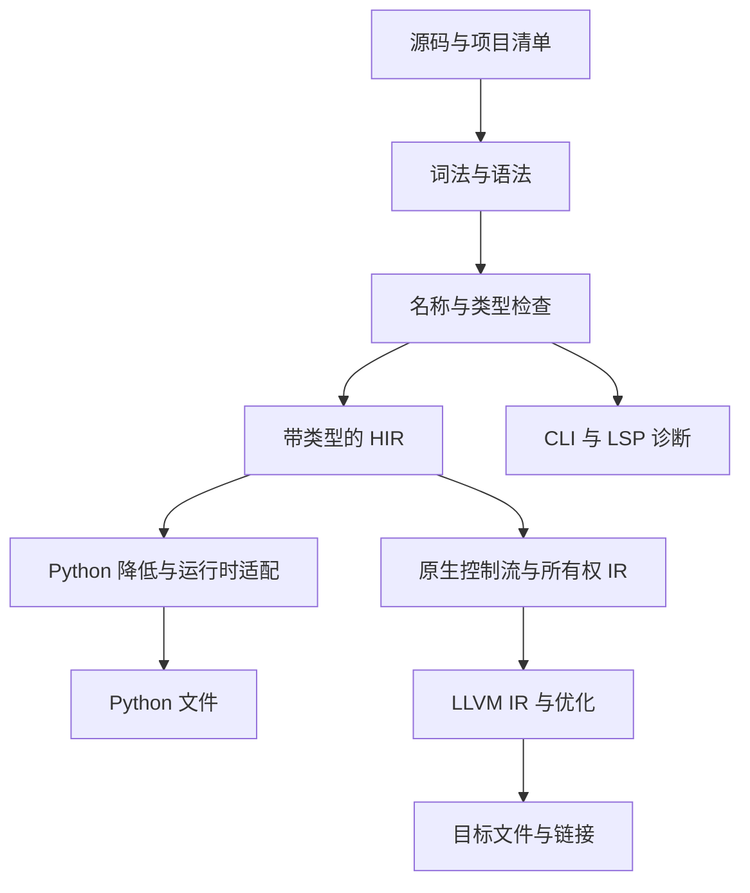

# 编译器开发说明 v0.1

架构与接口基线始于 2026-11-03。发布名为 Woozy，编译器命令为 `woozyc`，正式源文件后缀为 `.wz`。本文保留初始架构与任务说明，当前实现和检查状态见 [README](README.md)。

## 1 开发目标和当前状态

实现一门接近 Go/C 表层语法的静态类型语言。局部类型可以推断，支持泛型、明确的错误传播和自动内存管理；原生后端面向系统编程，Python 后端首先接入 NumPy 与 PyTorch。语法、名称和类型检查必须能够脱离代码生成独立运行，供 CLI、编辑器和 AI agent 复用。

现有成果是 [词法语法规范](baseline/LEXICAL_SYNTAX.md)、[参考文法](baseline/grammar.ebnf)、完整样例和语法检查原型。类型检查、LLVM 代码生成、Python 转译、ARC 及语言运行库尚待实现。原型的测试通过只证明相应词法和语法分类成立。

本轮新增的实施默认值列在第 3 节及 [SEMANTICS.md](docs/SEMANTICS.md)。它们用于统一 agent 的实现，不能声称已经得到运行验证；后续修改要同时更新行为测试和契约版本。

## 2 第一版范围

| 范围 | 第一版要求 |
| --- | --- |
| 前端 | 全部 v0.1 语法可解析；按能力逐步完成语义检查；暂不支持的功能给出明确诊断 |
| 静态类型 | 局部推断、显式接口、整数和浮点、结构体、枚举、函数类型、泛型与单一 trait 约束 |
| 错误 | typed `throws`、自动传播、边界 `try/catch`；`Result` 是普通枚举 |
| 内存 | 原生值语义与受限 ARC；普通传参不消费，`move` 和 `inout` 明确约束 |
| 原生后端 | AOT 编译；先 Linux x86_64，再 Linux AArch64、Windows x64、macOS ARM64 |
| Python 后端 | 公共语义子集和声明式 Python 绑定；首先运行已有 NumPy/PyTorch CPU 示例 |
| 互操作 | C ABI 声明与受控 C++ 包装；直接导入复杂 C++ 模板后续实施 |
| 工具 | 独立 `check`、结构化诊断、IR 导出；LSP 复用前端 |

第一版不实现 JIT、MLIR、宏、异步、用户定义类继承、跨线程 ARC、捕获环境的闭包、完整 C++ 头文件自动导入、GPU kernel 编译或自动将全部 Python 库变为静态接口。

以上是实施范围，不删除参考文法中的表达能力。阶段未覆盖的合法语法使用 `E_CAPABILITY_UNAVAILABLE`，不能静默忽略或随意修改语法来绕过。

## 3 本轮实施决策

| 编号 | 决策 | 原因与约束 |
| --- | --- | --- |
| D01 | C++20 实现正式编译器 | 直接使用 LLVM/Clang 接口；Python 原型保留为对照 |
| D02 | LLVM、Clang、LLD 固定 22.1.8 | 使用已发布版本作为开发基线，不声称是最新版；升级统一变更 |
| D03 | 手写 lexer，声明语句递归下降，表达式 Pratt/优先级爬升 | 现有语法规模可控，便于诊断和错误恢复 |
| D04 | 公共前端不依赖 LLVM，也不启动 Python | 保持检查速度和两个后端的独立性 |
| D05 | 类型检查后的结构化 HIR 是两个后端的分流点 | 保存类型、调用目标、错误效果、源码顺序和外部绑定信息 |
| D06 | 原生控制流 IR 再降低到 LLVM IR | 在 LLVM 前显式处理所有权、清理和错误分支 |
| D07 | 原生泛型采用单态化，trait 静态分派 | 先实现可内联的明确行为，实例化数量受预算限制 |
| D08 | 原生 `throws` 使用显式成功/错误通道 | 初期不依赖平台栈展开；代价是状态检查，必须测量 |
| D09 | 定宽整数加减乘和取负回绕 | 两后端统一，不给普通整数指令无条件添加 `nsw/nuw` |
| D10 | 原生 Vec 使用共享引用，赋值不深复制 | ARC 维护拥有句柄；`let` 不代表对象深度不可变 |
| D11 | 先用声明式 Python 绑定与 C++ 包装 | 检查阶段不执行外部包；跨语言所有权由绑定说明 |
| D12 | 原生和 Python 支持矩阵显式检查 | 不支持的导入和操作在编译阶段报告，禁止偷偷改后端 |

完整数值、错误、清理和别名规则以 [SEMANTICS.md](docs/SEMANTICS.md) 为准。复杂浮点转换、弱引用、并发和完整 ABI 不靠 agent 自行猜测；这些功能在对应规范与测试补齐之前保持未支持。

## 4 架构

HIR 初期可以是带 `SymbolId`、`TypeId` 和效果信息的规范化 AST，不必先建设通用 IR 框架。原生 IR 使用基本块和显式清理边，Python 保留结构化控制流。两端必须共享源语言规则，不从 LLVM IR 反向恢复 Python。

不要把 `llvm::Value*`、`LLVMContext`、`PyObject*` 或导入的 Python 模块对象放入公共 AST/HIR。外部接口只保留稳定的描述 ID，真正的后端对象在各自模块内部维护。

## 5 模块责任与目标代码目录

下表是 T00 创建工程时采用的目录约定；这些目录的存在不表示功能已经实现。

| 目标目录 | 负责内容 | 允许依赖 |
| --- | --- | --- |
| `src/support/` | SourceManager、ID、诊断、文件抽象、预算 | 标准库及获准基础依赖 |
| `src/syntax/` | token、trivia、AST、解析恢复 | support |
| `src/modules/` | 清单、逻辑模块、导入索引、依赖图 | support、syntax |
| `src/sema/` | 名称、类型、约束、错误效果与合法性检查 | support、syntax、modules |
| `src/hir/` | typed HIR、验证、稳定的文本调试输出 | support；不依赖后端 |
| `src/native_ir/` | 单态化后调用、CFG、移动、清理、ARC 操作 | hir |
| `src/codegen_llvm/` | LLVM 类型、指令、验证、优化、目标文件 | native_ir、LLVM |
| `src/codegen_python/` | Python 结构化输出、语义适配、绑定调用 | hir、绑定描述 |
| `src/bindings/` | 纯声明绑定读取、签名索引 | support、类型描述 |
| `src/driver/` | CLI、目标配置、编译阶段组合、链接驱动 | 前述模块 |
| `src/lsp/` | 文档快照、位置转换、补全和诊断 | 公共前端，不加载 LLVM |
| `runtime/native/` | 内存分配、ARC、Panic、平台适配 | 明确选择的平台接口 |
| `runtime/python/langrt/` | 数值、值复制、错误、清理适配 | Python 标准库；外部库由项目声明 |
| `bindings/` | 标准库、Python、C/C++ 接口声明 | 声明文件，无任意检查期脚本 |
| `tests/` | 词法、语法、语义、IR、执行、跨后端测试 | 按测试类别隔离依赖 |

公共 ID 的生命周期、源码位置和 IR 不变量在 [IR_CONTRACTS.md](docs/IR_CONTRACTS.md)；代码生成接口在 [BACKENDS.md](docs/BACKENDS.md)。

## 6 关键接口约定

各阶段返回结构化结果与诊断，不在库内部直接退出进程。只有 driver 决定 CLI 退出码。C++20 不依赖 C++23 的 `std::expected`，可用项目内 `Result`/`std::variant` 表达失败；这与源语言普通枚举 `Result[T,E]` 是不同概念。

| 阶段 | 输入 | 输出与必要保证 |
| --- | --- | --- |
| parse | 不可变源码快照 | 可恢复 AST、源码 span、语法诊断；无需模块可用 |
| resolve | AST、模块索引 | 绑定 ID、导出接口、依赖图；不能靠运行 Python 找接口 |
| check | 已解析名字、类型环境、目标能力 | typed HIR；类型/效果/能力错误不得进入代码生成 |
| lower native | HIR、目标配置 | 原生 IR；所有活跃路径的清理与所有权可验证 |
| lower Python | HIR、绑定和运行时版本 | Python 表示、源码映射、运行依赖；不隐式改变数值或 Tensor 行为 |
| emit | 已验证后端 IR | LLVM IR、目标文件或 `.py`；生成后验证失败属于编译器错误 |
| link | 目标文件、运行库、SDK 配置 | 目标可执行文件或库；无目标 SDK 时明确失败 |

源程序 `throws` 与实现编译器自身的错误返回分开。编译器内部错误不能包装成“用户语法错误”；后端失败不能回退为另一种语言或运行方式后仍报告原目标成功。

## 7 模块与标准库

逻辑导入保留既有约定：`std` 由工具链提供，`app` 指向项目源根，其余首段由项目清单声明。安装目录、项目 vendor 和缓存位置由清单及锁文件决定，源码不携带绝对路径。

首批基础库按使用顺序实施：`Unit/bool/数值/string`、Vec、Option/Result、`std/py`、`std/os` 的最小 I/O，再扩展路径、文件、时间、JSON、集合等。参考 Python 基础库的分类和易用性，不承诺第一版覆盖其全部 API。

`os.write` 采用可移植句柄及错误类型；Linux 原始 syscall、Windows 稳定系统 API 置于平台实现中。原始系统调用能力保持 native-only，并需要单独 ABI 声明。不要把 Linux 的整数 fd 当成所有平台的完整文件句柄设计。

## 8 LLVM 与两类互操作

LLVM 接入细节按 [BACKENDS.md](docs/BACKENDS.md) 实施。IR verifier 仅检查 LLVM 的内部规则，源语言类型、错误和所有权先由前端与本语言 IR verifier 检查。模块在生成前固定 target triple 与 DataLayout；函数 ABI 降低还需单独处理聚合参数、返回值和外部调用约定。

Python 后端保持 ndarray/Tensor 及 `model(x)` 调用。`throws py.Error` 在函数边界描述可传播的外部错误，不能把每次调用都改成源语言 `Result` 或要求加 `?`。NumPy/PyTorch 接口由声明文件导入，不在 `check` 时启动 Python、导入包或枚举 GPU。

C++ 第一版用受控包装与不透明句柄，包装函数捕获 C++ 异常并转换为明确的错误通道；任何异常都不能穿过未经定义的跨语言边界。采用 C ABI 不要求把本语言源码翻译成 C。复杂模板、重载和直接 C++ 对象布局导入后续复用 Clang。

## 9 实施顺序和并行边界

任务由 [tasks.json](contracts/tasks.json) 描述，详细验收在 [IMPLEMENTATION_PLAN.md](docs/IMPLEMENTATION_PLAN.md)。T00 至 T04先形成稳定前端基础；T05 原生标量、T06 Python 标量与 T07 泛型/枚举可以在公共接口稳定后并行。随后完成错误与清理、受限 ARC、外部库及跨平台集成。

各 agent 只修改领取任务的目录。共享类型和 IR 契约的修改由集成负责人统一合入；消费方使用同一版本，不能私自复制接口结构。文档和真实实现不一致时，先记录最小差异及受影响的任务，优先修复实现；确需改变语义时更新决策、契约和验收案例。

## 10 验收原则

1. 每阶段明确接受、拒绝和暂未支持的能力，不能用空实现通过检查。
2. 公共语义用同一组程序在 native 与 Python 后端比较结果；差分不能代替独立预期值。
3. LLVM 优化前后都验证 IR；O0 与 O2 的可观察行为须一致。
4. 正常返回、提前返回、throw、catch、break、continue 都要验证清理路径。
5. 交叉编译成功、目标机器实际运行成功、性能测量是三类不同证据。
6. 缺少 PyTorch 或目标 SDK 报告为未执行/环境阻塞，不能标成通过。

语法原型的历史 59 项自测、7 个正例和 9 个负例只作为输入证据。本轮包级检查和后续编译器验收分别记录，禁止复用历史结果冒充新实现已通过。

## 11 延后但必须保持接口位置的事项

| 事项 | 何时补充 |
| --- | --- |
| 弱引用与引用循环处理 | 开放通用对象图前明确 runtime 和标准库接口 |
| 跨线程引用计数与数据竞争 | 开放线程/异步前；引用计数原子化本身不等于线程安全 |
| 捕获闭包 | 定义捕获复制、移动、借用逃逸后 |
| 稳定二进制模块 ABI | 包分发与跨编译器版本兼容成为需求时 |
| MLIR 与张量优化 | 语言开始自行编译算子、融合或生成设备内核时 |
| 完整 C++ 导入 | 基础包装路线稳定且已有真实需要覆盖的 API 集合时 |
| 静态 shape/device 推理 | 类型表示与库约束足够明确后；当前绑定不作此承诺 |

## 12 资料和变更方式

实现使用 [REFERENCES.md](docs/REFERENCES.md) 中的官方资料。LLVM 源码与头文件以锁定版本为准；在线主分支文档不能覆盖本项目的契约。

实施默认值变更必须记录：旧行为、新行为、原因、影响的接口与任务、迁移方式、对应测试。第一版不要求 ABI 稳定，但同一个提交内前端、后端、运行库和绑定的契约版本必须匹配。
